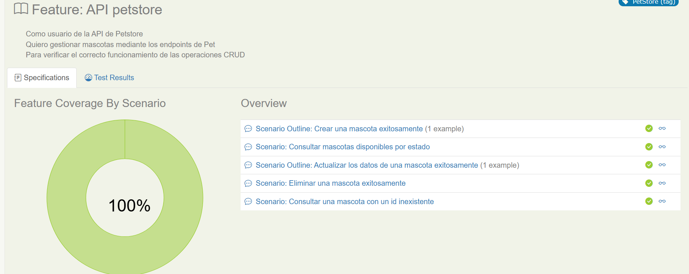
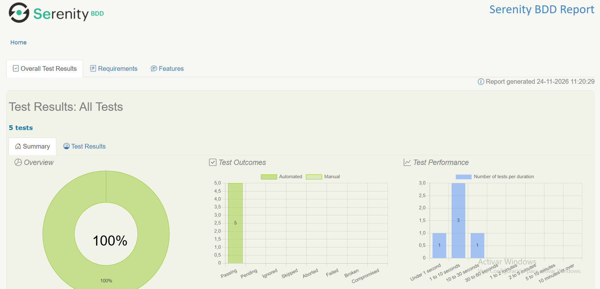
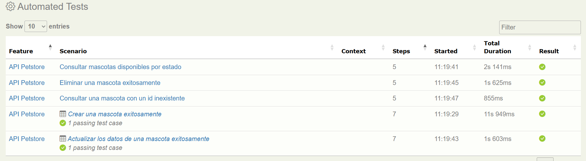
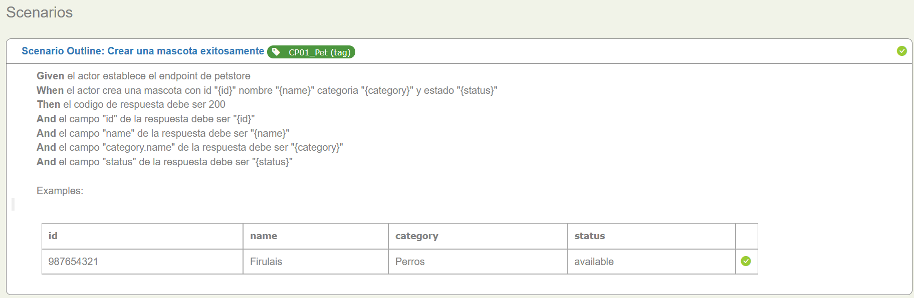
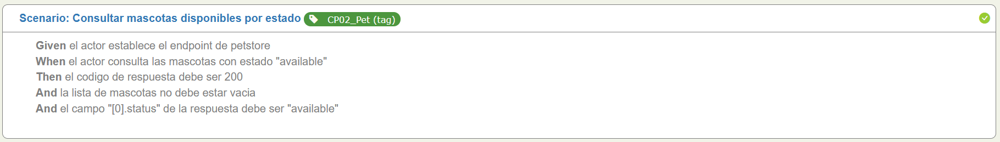
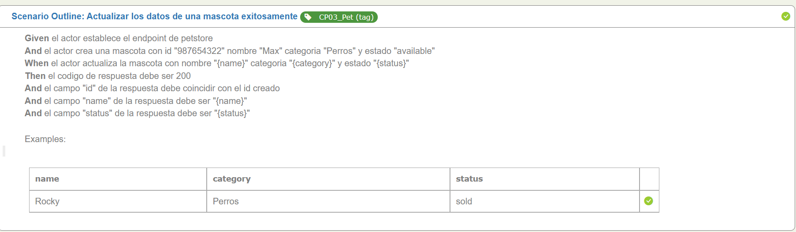
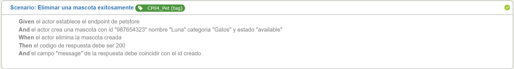
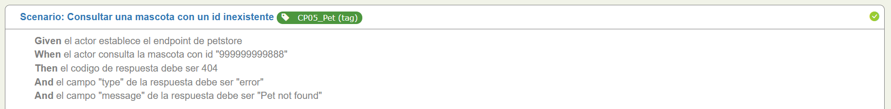

# Automatización de Pruebas API - Swagger Petstore

Este proyecto contiene la automatización de pruebas para la API pública de **Swagger Petstore**, desarrollada con Java 22, Maven, Serenity BDD (patrón Screenplay REST) y Cucumber.

Documentación oficial de la API: [Swagger Petstore](https://petstore.swagger.io/)

## Configuración Base

| Parámetro | Valor |
| --- | --- |
| BASE_URL | `https://petstore.swagger.io/v2` |
| JDK | 22 |
| Framework | Serenity BDD 4.2.1 + Cucumber + JUnit 4 |

## Endpoints y Tasks

Se implementó una clase `Task` por cada verbo HTTP utilizado:

| Verbo | Endpoint | Task | Descripción |
| --- | --- | --- | --- |
| POST | `/pet` | `PostPet` | Crea una nueva mascota y guarda su `petId` |
| GET | `/pet/findByStatus?status={status}` | `GetPet` | Consulta mascotas filtradas por estado |
| GET | `/pet/{petId}` | `GetPet` | Consulta una mascota por su ID |
| PUT | `/pet` | `PutPet` | Actualiza los datos de la mascota creada |
| DELETE | `/pet/{petId}` | `DeletePet` | Elimina la mascota creada |

## Estructura del Proyecto

```text
Automatizacion-API-Petstore/
├── pom.xml
├── images/
└── src/
    ├── main/java/com/nttdata/testing/
    │   ├── questions/
    │   │   ├── ResponseCode.java
    │   │   ├── ResponseField.java
    │   │   └── ResponseListSize.java
    │   └── tasks/
    │       ├── DeletePet.java
    │       ├── GetPet.java
    │       ├── PostPet.java
    │       └── PutPet.java
    └── test/
        ├── java/com/nttdata/testing/
        │   ├── RunnerTest.java
        │   └── stepDefinitions/
        │       ├── ParameterDefinition.java
        │       └── PetStoreStepDefinition.java
        └── resources/features/
            └── PetStoreAPI.feature
```

## Ejecución de Pruebas

Para ejecutar todos los escenarios y generar el reporte de Serenity:

```bash
mvn serenity:aggregate
```

El reporte HTML se genera en: `target/site/serenity/index.html`.

## Escenarios en Gherkin (`PetStoreAPI.feature`)

Se cubren 4 escenarios positivos y 1 escenario negativo con validaciones de código HTTP y campos de la respuesta JSON.



## Reporte Serenity

### Resumen General



### Resultados de Pruebas



## Detalle de Escenarios

### CP01 - Crear una mascota exitosamente (Positivo)

| Campo | Valor |
| --- | --- |
| Endpoint | `POST /pet` |
| Status esperado | `200` |
| Validaciones | `id`, `name`, `category.name` y `status` coinciden con los datos enviados |



### CP02 - Consultar mascotas disponibles por estado (Positivo)

| Campo | Valor |
| --- | --- |
| Endpoint | `GET /pet/findByStatus?status=available` |
| Status esperado | `200` |
| Validaciones | La lista de mascotas no está vacía y `[0].status` es `available` |



### CP03 - Actualizar los datos de una mascota exitosamente (Positivo)

| Campo | Valor |
| --- | --- |
| Endpoint | `PUT /pet` |
| Status esperado | `200` |
| Validaciones | `id` coincide con el creado, `name` actualizado a `Rocky` y `status` a `sold` |



### CP04 - Eliminar una mascota exitosamente (Positivo)

| Campo | Valor |
| --- | --- |
| Endpoint | `DELETE /pet/{petId}` |
| Status esperado | `200` |
| Validaciones | `message` coincide con el `id` de la mascota eliminada |



### CP05 - Consultar una mascota con un id inexistente (Negativo)

| Campo | Valor |
| --- | --- |
| Endpoint | `GET /pet/999999999888` |
| Status esperado | `404` |
| Validaciones | `type` es `error` y `message` es `Pet not found` |


